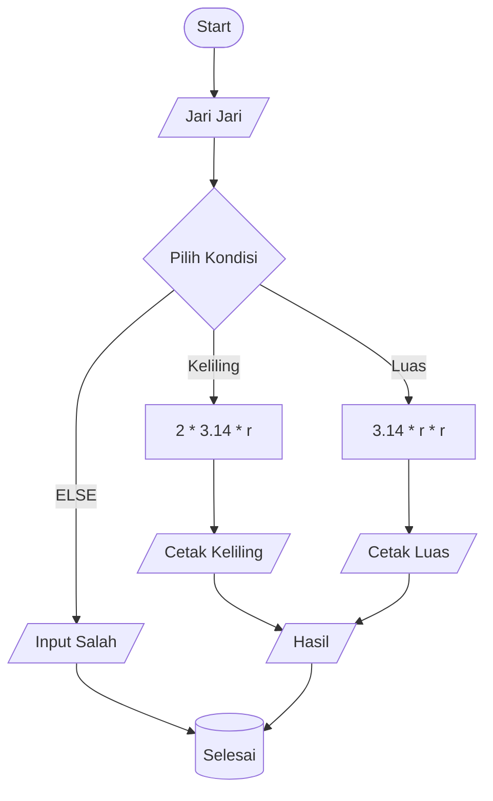

# Membuat program hitung luas dan keliling lingkaran

## Alur kerja program

- Membuat 2 function (hitungAwal dan hitungKedua).
- Menjalankan function hitungAwal dengan parameter r & kondisi, dan menjalankan function hitungKedua dengan tanpa parameter.

## Flowchart

